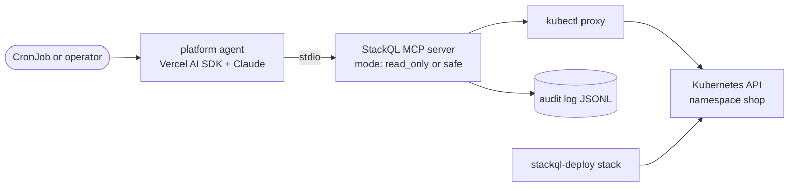

# demo: a platform built for the agent persona

Demo assets for "AI native platform engineering: building the platform when agents are the primary consumer" (Cloud Native Summit APAC 2026, Melbourne). The running order and the slides are in [../slides.md](../slides.md).

Three parts, one estate:

- `stack/` - the estate as a [stackql-deploy](https://stackql-deploy.io) stack: a `shop` namespace with a two-replica `web` deployment, a one-replica `checkout` deployment and a ClusterIP service, on a local kind cluster. No state file; every build asserts each resource against the live API.
- `agent/` - the always-on platform agent: [Vercel AI SDK](https://github.com/vercel/ai) v7, a Claude model through `@ai-sdk/anthropic`, and the StackQL MCP server (`@stackql/mcp-server`) over stdio as its only tool surface. Intent in prose, no SQL in the code; the agent discovers the k8s API surface itself.
- `k8s/` - the agent as a workload: a CronJob with a ServiceAccount and Role, a Secret for the model key, the server mode in the Pod spec, a kubectl proxy sidecar, and an audit volume.



## layout

| Path | What it is |
| --- | --- |
| `stack/stackql_manifest.yml`, `stack/resources/*.iql` | the estate: namespace, two deployments (one resource file, two uses), service, a post-build summary query |
| `agent/src/agent.ts` | the agent: one file. Starts the MCP server in the mode the platform chose, renders the prompts, runs the loop, prints every statement and a cost line |
| `agent/prompts/system.md` | the discovery briefing: how to find resources and contracts through StackQL, dialect facts, the write rules |
| `agent/prompts/intent.md` | the intent: a scheduled health check of the namespace, with `{{ placeholders }}` filled from `.env` |
| `agent/Dockerfile` | the agent as an image, with the stackql binary and the k8s provider baked in |
| `k8s/agent-cronjob.yaml` | ServiceAccount, Role, RoleBinding, Secret, CronJob with the kubectl proxy as a native sidecar |
| `scripts/setup.sh` | kind cluster, k8s provider, agent dependencies |
| `scripts/proxy.sh` | `kubectl proxy` for the k8s provider (leave running) |
| `scripts/perturb.sh` | the planted problem: points the checkout image at a tag that does not exist |
| `scripts/restore.sh` | `stackql-deploy build`: converges the image back |
| `scripts/shell.iql` | the human view of the same estate, for `stackql shell` |
| `.env.example` | every variable, documented |

## prerequisites

- `stackql` on PATH ([downloads](https://stackql.io/downloads)) and `stackql-deploy` (`pip install stackql-deploy`)
- `kind`, `kubectl`, Docker (for kind)
- Node 22 or later
- an Anthropic API key

## setup

```bash
cp .env.example .env            # fill in ANTHROPIC_API_KEY; the defaults suit a local kind cluster
set -a; source .env; set +a
scripts/setup.sh                # kind cluster, REGISTRY PULL k8s into $STACKQL_APPROOT, npm install
scripts/proxy.sh                # second terminal, leave it running
stackql-deploy build stack demo --env-file .env --show-queries     # about a minute from nothing
```

Providers are pulled into `STACKQL_APPROOT` (default `~/.stackql`), which is the directory the npm launcher uses by default, so the shell and the agent see the same provider. Pass `--approot "$STACKQL_APPROOT"` to any `stackql` command you run by hand. `stackql-deploy` pulls the providers its manifest declares into `.stackql/` under the current directory on first build (gitignored here).

On Windows, run `stackql-deploy` with `PYTHONUTF8=1` set: it draws its progress boxes with characters the default console code page cannot encode, and crashes otherwise.

## running order

| Step | Command | What you see |
| --- | --- | --- |
| 1 | `stackql-deploy build stack demo --env-file .env --dry-run`, then without `--dry-run` | every query rendered, then a converge of about 20 seconds against the warm cluster |
| 2 | `stackql shell --approot "$STACKQL_APPROOT"`, paste from `scripts/shell.iql` | deployments, pods and Warning events in `shop`, as a human reads them |
| 3 | `scripts/perturb.sh` | one UPDATE; `kubectl -n shop get pods -w` shows the new checkout pod in ImagePullBackOff |
| 4 | `cd agent && npm run agent` | the tool calls stream past: library search, list, describe, select; a diagnosis; a proposed UPDATE; the write refused (`read_only`) |
| 5 | `STACKQL_MCP_MODE=safe npm run agent` | same intent; the write pauses for approval at the terminal; decline it |
| 6 | `scripts/restore.sh` | the statecheck on the image fails, the update anchor runs, the estate converges |
| 7 | `ls -t runs/stackql_mcp_server_*.log \| head -1 \| xargs cat` | every statement the agent ran, one JSON line per tool call, with the mode and the outcome |

## the agent

```bash
cd agent
npm run agent                      # the intent, once
npm run agent -- --list-tools      # the tool surface and the mode, no model call
npm run agent -- --probe-write     # one harmless UPDATE with no model: refused in read_only, gated in safe
```

How it works:

- The agent starts the StackQL MCP server itself (stdio) with `--mcp.config {"server": {"mode": <STACKQL_MCP_MODE>, "audit": {"disabled": false}}}`. Only `read_only` and `safe` are accepted; the program exits on anything else. Provider credentials, if a provider needed any, would be in the server's process environment and never in the model's context.
- The server writes its audit sink, `stackql_mcp_server_<timestamp>.log` (JSONL, one line per tool call), into its working directory, so the agent starts it in `STACKQL_AUDIT_DIR` (default `runs/`) and prints the path at the end of the run.
- The system prompt is `prompts/system.md` plus the server's own instructions from the MCP initialize handshake, so the platform's current guidance travels with the briefing. The user prompt is `prompts/intent.md`. Both have `{{ placeholders }}` filled from `.env`; a missing value fails the run naming the variable.
- Tools are whatever the server exposes (`mcpClient.tools()`), passed to `generateText` with `stopWhen: isStepCount(AGENT_MAX_STEPS)`. The write tools stay visible by default so the server's refusal is what you see on screen; set `AGENT_HIDE_WRITE_TOOLS=true` for the production posture, where the model is never offered them.
- In `safe` mode the server raises an MCP elicitation before a write. The agent answers it from the terminal (approve or decline). A run with no TTY attached, such as the CronJob, declines automatically: a scheduled run has nobody to ask.
- Model options: adaptive thinking (always on for the Claude 5 family), `effort` from `ANTHROPIC_EFFORT` (`medium` default; it is the latency and cost control), and `fallbacks: 'default'` so a safety-classifier refusal is retried server-side on a fallback model.
- Every run ends with a block: steps, tool calls by name, writes attempted, tokens, a list-price estimate from the pricing table in the source, and the audit log path.

## the agent as a workload

```bash
docker build -t platform-agent:dev agent/
kind load docker-image platform-agent:dev --name platform-demo
kubectl create secret generic platform-agent -n shop --from-literal=ANTHROPIC_API_KEY="$ANTHROPIC_API_KEY"
kubectl apply -f k8s/agent-cronjob.yaml          # remove the Secret stanza from the file first, or let it be overwritten
kubectl -n shop create job --from=cronjob/platform-agent platform-agent-now
kubectl -n shop logs job/platform-agent-now -c agent -f
```

The kubectl proxy sidecar authenticates with the pod's ServiceAccount, so the Role in `k8s/agent-cronjob.yaml` is the agent's blast radius: remove the `patch` rule and a `safe` mode approval still changes nothing. The mode is an env var on the agent container, which is where a platform team reviews it.

## status

What has been exercised and what has not, as of the scaffold (16 October 2026, Windows, no cluster and no model key on the machine):

Verified:

- `npm run typecheck` passes; `--list-tools` starts the server through the npm launcher (stackql 0.12.778) and lists 15 tools in `read_only` mode, with the audit sink opened in `runs/`.
- `--probe-write` in `read_only`: the server refuses before any API call (`decision: refuse_immediate` in the audit sink).
- `--probe-write` in `safe`: the server raises an elicitation, the agent prints the approval box, a non-TTY run declines, the server records `needs_approval_declined`. Two client settings were needed for this and are in `agent.ts` with comments: advertise the `elicitation` capability, and turn off the SDK's `server/discover` probe so the session negotiates the 2025-11-25 revision (on 2026-07-28 the gated write comes back as an `input_required` result the SDK does not round-trip yet).
- `stackql-deploy build stack demo --dry-run` renders every query for all five resources.

Not yet exercised:

- The stack has not been built against a cluster, and the agent has not been run with a model. The resource files follow the k8s stacks in the KSUG and OpenAI sibling demos, which did run against real clusters.
- The CronJob manifest and the Dockerfile are written, not applied or built. Check the sidecar image tag against the cluster version before the first apply.
- `describe_method` with method `list` fails to parse on this server build (`list` is a reserved word); `get` works and returns the same output columns. The agent may hit this when it discovers a `list` method; the prompt tells it to use `describe_method`, so watch for it on the first real run and raise it upstream.
