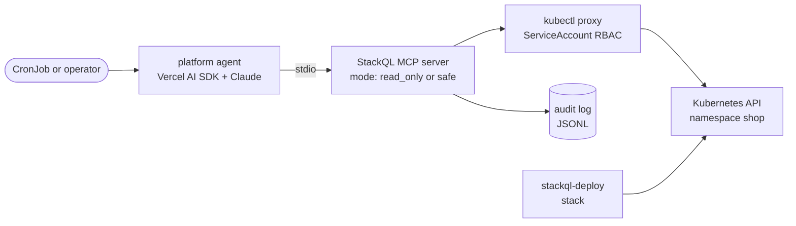

# AI native platform engineering: building the platform when agents are the primary consumer

Cloud Native Summit APAC 2026, Melbourne Convention and Exhibition Centre. Wednesday 28 October, 4:50 PM to 5:15 PM (25 minutes, last slot of the day). Speaker: Jeffrey Aven, StackQL.

The spine of the talk: platform engineering is a product discipline built for one persona, the human developer. The persona has changed. This deck walks through what inverts when the customer of the platform is an agent, then shows a platform built for that customer: a Kubernetes estate as a stackql-deploy stack, an always-on agent on the Vercel AI SDK and Claude using the StackQL MCP server, with agency set by the platform (server mode, identity, tool surface) rather than by the prompt.

Earlier talks (AI Engineer Melbourne June 2026, AAIF Melbourne August 2026, KSUG Melbourne September 2026) covered "infrastructure as data", the four strains in IaC and the six patterns. This deck compresses that material to one slide and does not repeat the Cloudflare and Confluent demo.

Budget: 14 content slides plus the demo. Finish at 24:00. No Q&A buffer is realistic in a 25 minute end-of-day slot.

## Slide 1 - Title

**Title:** AI native platform engineering: building the platform when agents are the primary consumer

**Content:**

- Cloud Native Summit APAC 2026, Melbourne
- Jeffrey Aven, StackQL
- stackql.io, github.com/stackql

**Image idea:** Full-bleed dark slide. A single Kubernetes Pod spec rendered as a code block on the left, with one highlighted line `serviceAccountName: platform-agent`. No stock imagery, no robots.

**Time:** 0:00 to 0:30

## Slide 2 - Who is the platform for?

**Title:** Platform engineering was built for one persona

**Content:**

- Platform as a product, developers as the customers (CNCF platforms white paper, Team Topologies)
- The whole playbook is about reducing developer cognitive load: portals, golden paths, self-service, scorecards, docs
- Every one of those is a product decision made for a human
- Ask the product question: who is actually using the platform in 2026?

**Image idea:** A persona card in the style of a UX research template. Name, role, goals, frustrations. "Priya, backend engineer. Wants to ship. Hates tickets and waiting on the platform team." Keep it to one card, centred.

**Time:** 0:30 to 2:00

## Slide 3 - The new persona

**Title:** Meet the new customer

**Content:**

The agent persona, on the same card template:

- Arrives with no memory of the last run
- Reads fast, follows structure, cannot browse a portal
- Retries and resumes by default
- Runs in parallel with copies of itself
- Never sleeps, never waits for office hours
- Can be prompt-injected by anything it reads
- Bills per token, not per seat

Every requirement in the rest of the deck is derived from this card.

**Image idea:** A second persona card beside the first, identical template. The agent card has no photo, just a cursor. The two cards side by side is the visual for the whole talk; reuse it as a section divider.

**Time:** 2:00 to 3:30

## Slide 4 - The inversion (part 1)

**Title:** What inverts when the customer changes

**Content:**

| Built for developers | When agents are the consumer |
|---|---|
| Portal and UI (Backstage) | Self-describing interface (MCP: list, describe) |
| Golden path is a template you copy | Golden path is a vetted query the agent searches for by intent, plus policy it cannot exit |
| Reduce cognitive load by hiding complexity | Manage context load with progressive disclosure |
| Docs the human reads | The interface is the documentation |
| Self-service through a form, ticket or PR | Self-service through a tool call, with the gate in the tool |

**Image idea:** Two-column table, left column in grey, right column in the accent colour. Rows animate in one at a time if the deck tool supports it; otherwise show all five.

**Time:** 3:30 to 5:00

## Slide 5 - The inversion (part 2)

**Title:** What inverts when the customer changes (continued)

**Content:**

| Built for developers | When agents are the consumer |
|---|---|
| PR review is the safety mechanism | Server mode is the safety mechanism |
| Onboarding takes weeks | Onboarding takes seconds: discover, describe, validate, run |
| One identity per human | One identity and one scoped tool server per agent |
| Scorecards run quarterly | Scorecards run continuously; the agent is subject and evaluator |
| Audit log is a compliance artefact | Audit log is the substrate the next run reads from |

**Image idea:** Same table styling as slide 4. Bottom caption: "Same discipline. Different customer."

**Time:** 5:00 to 6:30

## Slide 6 - Context load replaces cognitive load

**Title:** Context load replaces cognitive load

**Content:**

- For humans, the platform reduces cognitive load by hiding complexity behind abstractions
- An agent has a context budget, not a cognitive one. An abstraction that hides something from the human also hides it from the agent
- What the agent needs is progressive disclosure: start wide and cheap, narrow to one contract, then act
- In StackQL terms: list_services -> list_resources -> list_methods -> describe_method -> validate -> run
- The k8s provider: 20 services, hundreds of resources, and the agent loads one method's contract into context, not the whole API

**Image idea:** A funnel diagram. Top: "20 services". Next: "1 resource". Next: "1 method and its IO contract". Bottom: "1 statement". Each band labelled with the tool call that produces it. Monospace labels.

**Time:** 6:30 to 8:00

## Slide 7 - Golden paths as data

**Title:** Golden paths as data

**Content:**

- The developer golden path is a template directory you copy and then diverge from
- The agent golden path has two parts: a vetted query it finds by intent (the query library), and a boundary it cannot exit (server mode, RBAC, tool filter)
- The platform team writes the templates and sets the boundaries. The agent never sees the boundary; it only sees what is inside it
- A paved road the agent cannot leave is not a template. It is a constraint

**Image idea:** Left: a cookiecutter template tree (folders, files). Right: a single `query_library_search` call with intent "deployment ready replicas" returning an id and a rendered SELECT. Arrow from left to right labelled "same job, different shape".

**Time:** 8:00 to 9:15

## Slide 8 - Agency is a property of the process, not the prompt

**Title:** Agency is a property of the process, not the prompt

**Content:**

- The same intent, three outcomes, set by the server the agent is connected to:
  - `read_only`: the write is refused regardless of how the request is phrased
  - `safe`: the write stops and asks a human
  - `full_access`: the write executes (reserved for code paths, never a model-facing server)
- A prompt-injected instruction cannot change a mode. Nothing the agent reads can change a mode
- This is the platform equivalent of admission control, and it belongs to the platform team

**Image idea:** Three identical speech bubbles with the same text "scale checkout to 2 replicas" pointing at three server boxes labelled read_only, safe, full_access, with three outcomes beneath: "refused", "approve?", "done". The bubbles are identical on purpose.

**Time:** 9:15 to 10:30

## Slide 9 - The agent is a workload

**Title:** The agent is a workload

**Content:**

- Schedule it: a CronJob, not a chat window
- Give it an identity: a ServiceAccount and a Role. The Role is the blast radius
- Bound its tool surface: server mode and a filtered tool list, in the Pod spec
- Observe it: an audit log of every statement, tokens and cost per run
- Everything on this slide is a thing platform engineers already know how to build and review

**Image idea:** A Pod spec on the left (CronJob with two containers: the agent and a kubectl proxy sidecar), four callouts to the right pointing at `schedule`, `serviceAccountName`, the mode env var, and the audit volume mount.

**Time:** 10:30 to 11:30

## Slide 10 - Demo setup

**Title:** Demo: a platform built for the agent persona

**Content:**

- The estate: a `shop` namespace with two deployments and a service, declared as a stackql-deploy stack and asserted against the live API (no state file)
- The platform: the StackQL MCP server in `read_only` mode, the k8s provider, an audit log, credentials in the server process and never in the model
- The agent: Vercel AI SDK, Claude, an intent in prose. No query pack, no SQL in the code
- The beat: perturb the estate, run the agent, watch it discover and diagnose, see the write refused, flip the mode, see the write gated, converge with `build`

**Image idea:** The diagram above, rendered. Keep the audit log and the stack on the same slide as the agent so the three surfaces (reality, intent, history) are visible at once.

**Time:** 11:30 to 12:30

## Slide 11 - Demo (live)

**Title:** Demo

**Content:** Running order, about 9 minutes. Record a backup take beforehand.

| Step | What is on screen | What to say |
|---|---|---|
| 1 | `stackql-deploy build stack demo --dry-run` then `build` against the warm cluster | Desired state asserted against the live API. No state file. About 20 seconds when converged. |
| 2 | `stackql shell`: deployments, pods, events in `shop` | The same thing the agent is about to read, as a human would read it. |
| 3 | `scripts/perturb.sh` | One SQL statement points the checkout image at a tag that does not exist. |
| 4 | `npm run agent` (read_only) | Watch the tool calls: library search, list, describe, validate, select. Diagnosis and a proposed statement. The write is refused. |
| 5 | Set the mode to `safe`, run again | Same prompt. This time the write stops for approval. Decline it. |
| 6 | `stackql-deploy build stack demo` | The stack converges the image back. Idempotent assertion. |
| 7 | The newest `runs/stackql_mcp_server_*.log` | Every statement the agent ran, one JSON line per tool call, with mode and outcome. |

**Image idea:** No slide content beyond the title; the terminal is the slide. Use a large font and a dark theme in the terminal. Have the kind cluster warm and the first `build` already run once before the talk.

**Time:** 12:30 to 21:30

## Slide 12 - Same platform, three consumers

**Title:** Same platform, three consumers

**Content:**

- A human in the StackQL shell
- A human-assisted agent in Claude Desktop or GitHub Copilot, over the same MCP server in `safe` mode
- A headless agent on a schedule, over the same MCP server in `read_only` mode
- One tool surface, one audit log, one set of credentials held by the platform. Only the mode changes
- You do not build a platform per consumer. You build one surface and set agency per consumer

**Image idea:** Three lanes (shell, desktop client, CronJob) converging on one MCP server box, which fans out to the API server and the audit log. Lane labels carry the mode in a small badge.

**Time:** 21:30 to 22:30

## Slide 13 - What the platform team owns now

**Title:** What the platform team owns now

**Content:**

- The tool surface and its contract (what can be discovered, what can be called)
- The mode per consumer (read_only, safe, full_access)
- Identity per agent (ServiceAccount, Role, credentials in the process)
- The golden paths as data (the query library)
- The audit substrate (every statement, every outcome)
- The deployment pattern (the CronJob, the sidecar, the Secret)
- Not the prompt. The prompt belongs to the team that owns the intent

**Image idea:** A checklist with six ticked items and one crossed-out item ("the prompt"). Plain, large type.

**Time:** 22:30 to 23:15

## Slide 14 - If you saw the earlier talks

**Title:** Where this came from

**Content:**

- IaC strains under agents: single-writer state, review cycles that expect a human, opinionated abstractions, plane-bounded tooling
- Patterns that hold: query before mutation, idempotent assertions, bi-temporal view, agents as event sources, universal interfaces, policy gates
- This talk is the platform engineering view of the same shift: the persona changed, so the product changes

**Image idea:** A 2x3 grid of the six pattern names in grey, small, with the persona cards from slide 3 overlaid in the centre. One slide, ten seconds, no reading required.

**Time:** 23:15 to 23:30

## Slide 15 - Takeaways

**Title:** Takeaways

**Content:**

- Build for the persona you actually have. Agents are a customer of the platform now
- Put agency in the process, not the prompt. Mode, identity and tool surface are platform decisions
- Treat the agent as a workload. Schedule it, give it an identity, bound it, observe it
- Position: your portal is for humans. This is the equivalent for agents, alongside Backstage, Crossplane and Argo, not instead of them

**Image idea:** Three lines of large text, nothing else. The persona cards faded in the background.

**Time:** 23:30 to 24:00

## Slide 16 - Thank you

**Title:** Thank you

**Content:**

- stackql.io
- github.com/stackql/stackql (the engine and the MCP server)
- npm `@stackql/mcp-server`, PyPI `stackql-mcp-server`, crates.io `stackql-mcp`, NuGet `StackQL.Mcp`
- This talk and demo: github.com/stackql/agentic-platform-engineering

**Image idea:** QR code to the demo repository, large, on the right. Links on the left.

**Time:** 24:00 to 24:30

## Timing summary

| Slide | Cumulative |
|---|---|
| 1 Title | 0:30 |
| 2 Who is the platform for | 2:00 |
| 3 The new persona | 3:30 |
| 4 The inversion (1) | 5:00 |
| 5 The inversion (2) | 6:30 |
| 6 Context load | 8:00 |
| 7 Golden paths as data | 9:15 |
| 8 Agency is a property of the process | 10:30 |
| 9 The agent is a workload | 11:30 |
| 10 Demo setup | 12:30 |
| 11 Demo (live) | 21:30 |
| 12 Three consumers | 22:30 |
| 13 What the platform team owns | 23:15 |
| 14 Earlier talks | 23:30 |
| 15 Takeaways | 24:00 |
| 16 Thank you | 24:30 |

If the demo runs long, cut slide 14 first, then fold slide 12 into the spoken close over slide 13.

## Pre-talk checklist

- kind cluster up, `kubectl proxy` running, the stack built once so the live `build` is a converge of about 20 seconds
- `.env` sourced in the demo terminal; `ANTHROPIC_API_KEY` present; the model id in `.env` is the one you rehearsed with
- The agent run once in the last hour so the StackQL binary and the k8s provider are cached
- Backup recording of steps 3 to 7 on local disk, not in the cloud
- Terminal font at 18pt or larger, dark theme, one window per step laid out in advance
- The perturb statement and the restore statement both open in the shell history
- On Windows, `PYTHONUTF8=1` exported in the terminal that runs `stackql-deploy` (it crashes drawing its progress boxes otherwise)
- `npm run agent -- --probe-write` run once in each mode before the talk, to confirm the gate without spending tokens
